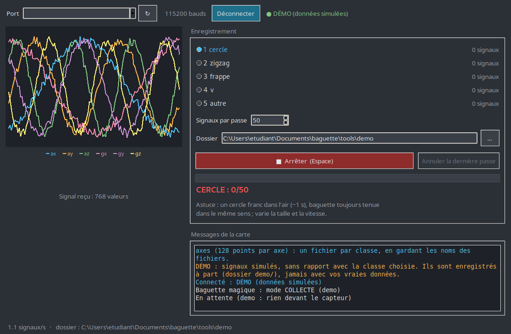

# Baguette magique : reconnaître des gestes dans l'air

NUCLEO-L476RG + **X-NUCLEO-IKS01A2** (accéléromètre + gyroscope LSM6DSL) + **NanoEdge AI** (classification
N-classes).

Tu tiens la carte comme une baguette et tu fais un geste dans l'air : **cercle**, **zigzag** (la lettre Z),
**frappe** ou **V**. Le STM32 reconnaît le geste à partir de 6 courbes (accélération et vitesse angulaire sur 3 axes),
sans PC :

```
GESTE cercle 100%   (zigzag 0% v 0% frappe 0% cercle 100% autre 0%)
GESTE cercle 66%   (zigzag 2% v 0% frappe 0% cercle 66% autre 32%)
GESTE - (autre mouvement)   (zigzag 8% v 6% frappe 4% cercle 12% autre 70%)
```

> **Une librairie NanoEdge qui fonctionne est fournie** (`Core/Inc/NanoEdgeAI.h`, `Core/Src/libneai.a`) :
> passer en mode reconnaissance (`APP_MODE 1`) permet d'essayer la baguette tout de suite. Elle a été
> entraînée avec **seulement 10 gestes par classe, faits par une seule personne**, vifs (~0,5 s) : elle
> reconnaît ces gestes-là, mais pas forcément les vôtres. **Le travail du hackathon** : collecter vos propres
> gestes, plus nombreux et plus variés, et générer une librairie qui reconnaît les 5 classes pour tout le monde.

Ce qui le rend intéressant :
- **Des signaux temporels**, le point fort de NanoEdge : une trajectoire dans le temps, pas une image.
- **Les gestes sont alignés sur leur début** : la fenêtre démarre quand la baguette bouge franchement, avec
  ~150 ms d'avance gardées en mémoire. Tous les exemples se ressemblent dans le temps, ce qui aide le modèle.
- **Une classe « autre »** pour les mouvements quelconques : la baguette ne prend pas chaque geste pour un sort.

```
baguette/
├── NUCLEO_L476RG_IKS01A2_BAGUETTE/   projet STM32CubeIDE = projet DataLogTerminal de ST (X-CUBE-MEMS1 9.6.0)
│   ├── Core/Inc, Core/Src            + app, imu_sensor, wand_preproc, wand_ai, uart_io, app_config.h
│   │                                   + librairie NanoEdge fournie (NanoEdgeAI.h, libneai.a)
│   └── MEMS/App/app_mems.c           modifié (zones USER CODE) : appelle app_init() / app_loop()
├── DEMARRAGE.md                       la liste des opérations, dans l'ordre, du PC vide aux premiers gestes
├── DIFFERENCES_ST.md                 liste détaillée des différences avec le projet de ST
├── tools/wand_logger_gui.py          collecte en interface graphique (outil commun outils/)
├── tools/wand_logger.py              la même chose en ligne de commande
├── tools/profil_collecte.json        profil de collecte : classes, 6 courbes de 256 points
├── tools/augmenter.py                variantes réalistes des gestes collectés (augmentation de données)
├── img/collecte_gui.png              capture de l'interface de collecte
└── tests/                            tests PC (make test) + CSV synthétiques (make synth)
```

---

## 1. Montage

- ⚠️ **Sortir les cartes de leur blister avec précaution** : les broches des connecteurs, sous les cartes,
  sont pointues et peuvent piquer les doigts. Tenir les cartes par les bords.
- Enficher la X-NUCLEO-IKS01A2 sur la NUCLEO-L476RG (connecteurs Arduino), puis brancher le câble USB
  (ST-LINK). Un câble long laisse plus de liberté pour les gestes.
- **Marquer un repère « haut / avant »** sur la carte et la tenir **toujours dans le même sens** : les axes
  du capteur tournent avec elle, et un geste fait la baguette retournée ressemble à un autre geste.

> ⚠️ **Respecter le matériel.** La baguette, ce sont deux cartes électroniques enfichées l'une sur l'autre :
> - **ne jamais taper la carte** sur la table, un objet ou une personne : tous les gestes, frappe comprise,
>   s'arrêtent **dans l'air** ;
> - **tenir la carte fermement**, par les bords, avec toute la main : une carte lâchée en plein geste tombe
>   ou part au bout du câble ;
> - **ne pas faire tournoyer la carte par le câble** et ne pas tirer dessus : le connecteur USB de la
>   NUCLEO s'arrache facilement ;
> - vérifier de temps en temps que la X-NUCLEO-IKS01A2 est **bien enfoncée** : les secousses peuvent la
>   faire sortir de ses connecteurs (la carte affiche alors `ERREUR : init LSM6DSL`).

## 2. Projet STM32CubeIDE

Le projet est celui que génère STM32CubeIDE pour la NUCLEO-L476RG avec X-CUBE-MEMS1 9.6.0 et l'application
IKS01A2_DataLogTerminal, auquel l'application a été ajoutée (voir `DIFFERENCES_ST.md`). Il n'y a rien à
configurer.

1. *File > Import > General > Existing Projects into Workspace* → sélectionner
   `NUCLEO_L476RG_IKS01A2_BAGUETTE/` (voir [`CUBEIDE_IMPORT.md`](../CUBEIDE_IMPORT.md)).
2. Choisir le mode avec `APP_MODE` dans `Core/Inc/app_config.h` : `0` = collecte (valeur par défaut),
   `1` = reconnaissance, avec la librairie fournie ou la vôtre (section 5).
3. Compiler, puis flasher via le ST-LINK.

Au démarrage, le terminal (115200 bauds) affiche « # Baguette magique : mode COLLECTE ». Si la carte
d'extension n'est pas reconnue : `# ERREUR : init LSM6DSL (carte X-NUCLEO-IKS01A2 bien enfichee ?)`.

## 3. Collecte des données (APP_MODE = 0)

### Les gestes à faire

Pour que NanoEdge apprenne, **tout le monde doit faire le même geste**, de la même façon. Les gestes se
tracent dans un plan vertical, **devant soi**, en environ **1 s**, la baguette tenue **toujours dans le même
sens** (repère « haut / avant », section 1). Les schémas sont vus par la personne qui fait le geste.

| Classe | Geste | Schéma |
|---|---|---|
| `cercle` | Un cercle complet, **dans le sens des aiguilles d'une montre**, en partant du haut | `↻` |
| `zigzag` | La **lettre Z** : un trait vers la droite, une diagonale vers le bas à gauche, un trait vers la droite | voir ci-dessous |
| `frappe` | Un coup sec **vers le bas**, comme un coup de baguette magique, avec un **arrêt net dans l'air**. **Sans jamais toucher la table** ni aucun objet | `↓` puis stop |
| `v` | La **lettre V** : une diagonale vers le bas à droite, puis une diagonale vers le haut à droite | voir ci-dessous |
| `autre` | Tout ce qui ne doit **pas** être reconnu : se gratter la tête, poser ou reprendre la baguette, gestes hésitants, secousses | — |

```
   zigzag (Z)              v (V)

   ———————→             ↘         ↗
         ↙                ↘     ↗
       ↙                    ↘ ↗
   ———————→
```

- Un geste = **un seul tracé, sans pause au milieu** : la fenêtre de 2,5 s démarre au premier mouvement franc.
- ⚠️ **Tous les gestes se font dans l'air** : la carte ne touche jamais rien. Une vraie frappe sur la table
  abîme le matériel, et ses mesures ne ressemblent plus à celles des autres frappes (choc, saturation).
- Les capteurs sont réglés au maximum (±16 g, ±2000 °/s) : les courbes ne doivent plus **plafonner** (bloquées
  à 0 ou à 1000 dans l'interface). Si elles plafonnent encore, la frappe est trop violente : la ralentir.
- Faire varier la **taille** et la **vitesse** d'une passe à l'autre, mais jamais le **sens** du tracé : un
  cercle tracé dans l'autre sens est un autre geste pour le capteur.
- Les noms des classes sont libres (renommer dans `tools/profil_collecte.json`, les CSV et le Studio
  suivent) ; seule la classe `autre` a un rôle particulier dans le firmware (`WAND_REJECT_CLASS`).

### Collecter

1. Compiler avec `APP_MODE=0` et flasher. Sur le PC : `pip install pyserial`, puis :
   ```bash
   python tools/wand_logger_gui.py                  # interface graphique (recommandé)
   python tools/wand_logger_gui.py --demo           # pour la découvrir sans carte (données simulées)
   python tools/wand_logger.py --port COM5 --view   # ou en ligne de commande
   python tools/wand_logger.py --port COM5          # collecte guidée des 5 classes
   ```
   Ces deux scripts lancent l'outil de collecte commun du dépôt ([outils/](../outils/README.md)) avec le
   profil `tools/profil_collecte.json`.
2. **Le rythme** : la carte n'envoie rien tant que la baguette ne bouge pas (« # En attente d'un geste »).
   Un geste franc déclenche l'enregistrement ; la ligne CSV part une fois les 256 échantillons réunis
   (~2,5 s), puis met ~0,7 s à arriver. Il faut ensuite **immobiliser la baguette un instant** (0,3 s) avant le geste suivant.
3. **L'interface** affiche les 6 courbes de chaque geste reçu : on vérifie d'un coup d'œil qu'il est complet
   (il ne doit pas être coupé à droite) et qu'il ressemble aux précédents.

   

   *Capture en mode `--demo` (courbes simulées, pas de vrais gestes).*
4. Choisir la classe (touches `1` à `5`), **Espace**, puis enchaîner les gestes : 50 par passe. Les fichiers
   `cercle.csv`, `zigzag.csv`, `frappe.csv`, `v.csv` et `autre.csv` vont dans `tools/`.
   **Geste raté** (mauvais geste, coupé, baguette cognée) : **Retour arrière** (bouton *Suppr. dernier*)
   le retire aussitôt, et la passe continue ; après la passe, chaque appui retire le geste précédent.
   *Annuler la dernière passe* retire les 50 d'un coup. Ne pas ouvrir les CSV avec Excel, qui peut les
   réenregistrer avec des `;` : utiliser un éditeur de texte (une ligne = un geste).
5. **Faire 3 à 6 passes par classe, en plusieurs séances** (à des moments différents), avec plusieurs
   personnes si possible, en variant la position, la taille et la vitesse du geste. Viser ~150 gestes par
   classe, `autre` compris.
   Pour **autre** : se gratter la tête, poser et reprendre la baguette, gestes hésitants… tout ce qui ne doit
   pas être reconnu.
6. Garder une passe de chaque classe pour la validation : relancer l'outil avec `--out test`.

**Format d'un signal** : 256 échantillons × 6 axes = **1536 entiers**, entrelacés
`ax0, ay0, az0, gx0, gy0, gz0, ax1…`, capteur à **104 Hz** (cadence fixe imposée par le capteur). Chaque
valeur va de 0 à 1000, **500 = zéro** : 1 unité = 32 mg pour l'accélération (±16 g) et 4 °/s pour la
vitesse angulaire (±2000 °/s). Les 16 premiers échantillons sont ceux d'avant le déclenchement.

### Augmenter les données (facultatif)

`tools/augmenter.py` fabrique, à partir de chaque vrai geste, des **variantes réalistes** : geste plus
lent ou plus rapide (la rotation et l'accélération suivent, pas la gravité), plus ou moins ample, baguette
tenue un peu de travers (accéléro et gyro tournent ensemble : le sens du geste ne change pas), départ
décalé, léger bruit. Aucune variante n'est coupée en fin de fenêtre ni ne sature.

```bash
python tools/augmenter.py              # tools/*.csv -> tools/augmente/ : vrais gestes + 10 variantes chacun
python tools/augmenter.py -n 5 --force 1 --sortie essai   # autres réglages (force 0,5 par défaut)
```

Les fichiers vont dans un **dossier à part** (`tools/augmente/`, mêmes noms), à importer dans le Studio à
la place des vrais. Trois précautions :
- **ça ne remplace pas la collecte** : les variantes restent des copies déformées des mêmes gestes ; il faut
  toujours de vrais gestes variés, en plusieurs séances ;
- **le score du Studio devient trop optimiste** (des variantes d'un même geste tombent dans l'entraînement
  et dans le test) : juger sur la carte, ou avec des fichiers de test de **vrais** gestes (`--out test`) ;
- **plus fort n'est pas mieux** : à `--force 1`, les cercles déformés ont « avalé » une partie des `autre`
  dans un essai sur 10 gestes par classe ; à 0,5, tous les gestes et 8 `autre` sur 10 restaient reconnus.

## 4. Générer la librairie NanoEdge AI

Dans **NanoEdge AI Studio**, le logiciel gratuit de ST :

1. **Créer le projet** : nouveau projet de type **N-Class classification**.
2. **Paramètres** : cible **STM32L476RG** ; capteur **Generic** avec **6 axes** ; 256 points par axe.
   - **Ne pas choisir *Accelerometer*** : ce type ne prend que 1 à 3 axes d'accélération, sans gyroscope.
     *Generic* accepte nos 6 mesures (3 axes d'accéléromètre + 3 axes de gyroscope) ; le Studio ne connaît
     pas la signification des axes et n'en a pas besoin.
   - *Number of axes* = **6**. Le Studio découpe alors chaque ligne de 1536 nombres en 256 instants de
     6 valeurs `ax, ay, az, gx, gy, gz`, l'ordre « entrelacé » qu'envoie la carte.
   - Ne pas choisir non plus *Multi-sensor* : il sert à combiner des capteurs à des fréquences différentes ;
     nos 6 axes sont tous à 104 Hz.
   - À l'import, le Studio doit annoncer **256 points × 6 axes** : sinon, vérifier le nombre d'axes.
3. **Signaux** : importer un fichier par classe (*Import from file*, séparateur virgule). **Garder les noms**
   : le firmware cherche la classe `autre` pour les mouvements à ignorer.
4. **Benchmark** : viser une précision équilibrée (*balanced accuracy*) d'au moins 90 %. La matrice de
   confusion montre les gestes confondus (par exemple zigzag / V, qui ont tous deux des diagonales) : compléter
   leurs données et relancer.
5. **Validation** dans l'émulateur avec les fichiers de test.
6. **Compilation** avec **Float ABI hard** et **FPU fpv4-sp-d16** : le Studio produit un `.zip`.

### Voir si des gestes sont confondus

Les noms exacts des boutons peuvent varier selon la version du Studio.

1. **Étape Signals, avant le benchmark : comparer les classes à l'œil.** Chaque classe importée a son
   graphique (souvent la moyenne des signaux, avec une zone min/max). Si deux classes ont des courbes presque
   superposées, le modèle aura du mal à les séparer.
2. **Étape Benchmark : la matrice de confusion** (le plus utile). Une fois le calcul terminé, le Studio
   affiche la meilleure librairie (balanced accuracy, RAM, flash) ; la *confusion matrix* s'ouvre depuis ce
   résultat ou le détail de la librairie. C'est un tableau classes réelles × classes prédites :
   - la **diagonale** donne les gestes bien reconnus, à viser proches de 100 % ;
   - **hors diagonale**, les confusions : 25 % sur la ligne `zigzag`, colonne `v`, signifie qu'un quart des Z
     ont été pris pour des V.
3. **Étape Validation : l'émulateur, sur des gestes jamais vus.** Importer les fichiers de **test**
   (`--out test`), classe par classe : pour chaque fichier, l'émulateur montre la classe prédite pour chaque
   signal. Si le `zigzag.csv` de test donne beaucoup de `v`, la confusion se retrouvera sur la carte. C'est le
   meilleur indicateur du comportement réel.

**Piège : benchmark parfait, reconnaissance médiocre sur la carte.** C'est arrivé lors du premier essai,
avec une fenêtre de 128 échantillons (1,2 s), un accéléromètre à ±4 g et une seule passe de 50 gestes par
classe :
- la matrice de confusion était diagonale, mais en direct presque tout ressortait en `zigzag` à 99 % ;
- **49 Z sur 50 étaient coupés** (encore en mouvement à la fin de la fenêtre) : le modèle avait appris
  « bouge encore à la fin = zigzag », et tout geste un peu lent finissait en `zigzag` ;
- **48 frappes sur 50 saturaient** l'accéléromètre (au-delà de ±4 g) ;
- une seule séance par classe : les gestes d'une même passe se ressemblent tellement que le benchmark est
  parfait, mais les gestes faits plus tard, autrement, sortent de ce que le modèle connaît.

D'où la fenêtre de 256 échantillons (2,5 s) et les capteurs à pleine échelle maximale (±16 g, ±2000 °/s :
à ±8 g et ±1000 °/s, 6 frappes sur 10 saturaient encore), et surtout : **collecter en plusieurs
séances**, à des moments différents, en variant position (debout, assis), taille et vitesse des gestes,
même seul.

**Si des gestes sont confondus**, du plus efficace au moins efficace :
1. **Les rendre vraiment différents** : comparer leurs courbes dans l'interface de collecte. Si elles se
   ressemblent, changer la façon de faire les gestes (tracés plus grands, plus francs), voire les gestes
   eux-mêmes.
2. **Une seule façon de faire chaque geste** : même orientation de la baguette, même sens du tracé, pour
   tout le monde.
3. **Retirer provisoirement la classe `autre`** et relancer le benchmark : si la précision remonte nettement,
   `autre` mélange tout. L'enrichir avec des mouvements nettement différents des 4 gestes.
4. **Plus de données** : 150 à 300 gestes par classe, plusieurs personnes, classes équilibrées.
5. **Des gestes complets** : aucun ne doit être coupé à droite des courbes. Sinon, les faire plus vite, ou
   allonger encore la fenêtre (`WAND_SAMPLES`, section 6) et recollecter.

💡 **Sans matériel**, `cd tests && make synth` génère des CSV **synthétiques** (200 gestes par classe)
dans `tests/data_synth/`, passés par le vrai découpage du firmware. Ils permettent d'essayer le parcours du
Studio, pas d'obtenir un vrai modèle.

## 5. Intégrer la librairie et reconnaître les gestes (APP_MODE = 1)

1. Depuis le `.zip`, copier dans `NUCLEO_L476RG_IKS01A2_BAGUETTE/` :
   - `NanoEdgeAI.h` → `Core/Inc/` ;
   - `libneai.a` → `Core/Src/`,

   à la place de la librairie fournie. **Garder une copie** de vos deux fichiers hors du dépôt : un
   `git checkout` ou un `git stash` remet la librairie fournie.
2. Mettre `APP_MODE` à `1` dans `Core/Inc/app_config.h`, faire *Project > Clean*, recompiler, flasher.
3. Ouvrir un terminal série (Tera Term) à **115200 bauds**. Le menu affiche les classes de la librairie.
4. Immobiliser la baguette : **LED allumée = prête**. Faire un geste : une ligne `GESTE …` s'affiche avec la
   probabilité de chaque classe, et la LED clignote si le geste est reconnu.

| Ligne affichée | Signification |
|---|---|
| `GESTE cercle 91%  (…)` | Geste reconnu (probabilité ≥ `WAND_MIN_CONFIDENCE`, 60 %) |
| `GESTE ? pas reconnu (zigzag 45%)  (…)` | Le modèle hésite : geste trop différent des exemples |
| `GESTE - (autre mouvement)  (…)` | Classe `autre` : mouvement à ignorer |

Les lignes `GESTE` sont faciles à lire par un script PC (touches du clavier, jeu…).

| Message | Cause et solution |
|---|---|
| `#error "Pas de librairie NanoEdge : copier NanoEdgeAI.h…"` à la compilation | `NanoEdgeAI.h` manque dans `Core/Inc` |
| `#error … n'attend pas WAND_SIGNAL_LEN valeurs` | Le projet Studio n'a pas 6 axes × 256 points |
| `#error … ne vient pas d'une librairie de classification` | Projet Studio d'un autre type : refaire un projet N-Class classification |
| `undefined reference to neai_…` à l'édition de liens | `libneai.a` et `NanoEdgeAI.h` ne viennent pas du même `.zip` : copier les deux |
| « uses VFP register arguments » / float-abi | Recompiler la librairie avec Float ABI **hard** et FPU **fpv4-sp-d16** |

## 6. Réglages (`Core/Inc/app_config.h`)

**Sans recollecter** (après NanoEdge, recompiler suffit) :

| Paramètre | Défaut | Rôle | Si… |
|---|---|---|---|
| `WAND_MIN_CONFIDENCE` | 0.60 | Probabilité mini pour accepter un geste | Trop de « pas reconnu » → 0.5 ; fausses reconnaissances → 0.7 |
| `WAND_TRIGGER_DPS` / `WAND_TRIGGER_MG` | 150 °/s / 600 mg | Seuils de déclenchement d'un geste | Gestes doux non détectés → baisser ; déclenchements intempestifs → monter |
| `WAND_CALM_DPS` / `WAND_CALM_MG` / `WAND_REST_MS` | 40 °/s / 150 mg / 300 ms | Calme exigé avant le geste suivant | Attente trop longue → baisser `WAND_REST_MS` |

Les seuils de déclenchement changent aussi le moment où démarre la fenêtre : s'ils sont modifiés beaucoup,
recollecter est plus sûr.

**Avec recollecte et nouvelle librairie** (le signal change) :

| Paramètre | Défaut | Rôle | Si… |
|---|---|---|---|
| `WAND_SAMPLES` | 256 | Échantillons par geste (~2,5 s) | Gestes encore coupés → 384 (et `longueur` = 2304 dans `tools/profil_collecte.json`, 384 points dans le Studio) |
| `WAND_PRETRIGGER` | 16 | Échantillons gardés avant le déclenchement | Début des gestes coupé → 24 |
| `IMU_ACC_FS_G` | 16 g | Pleine échelle de l'accéléromètre | Gestes doux seulement (pas de frappe) → 8 pour plus de finesse |
| `IMU_GYRO_FS_DPS` | 2000 °/s | Pleine échelle du gyroscope | Gestes lents seulement → 1000 pour plus de finesse |
| `IMU_ODR_HZ` | 104 Hz | Cadence du capteur | À garder |

**Améliorer les données**, souvent le plus efficace : plus de passes et de personnes, des gestes de tailles
et de vitesses variées, une classe `autre` bien fournie, des classes équilibrées, des données de test à part.

## 7. Tests sur PC

```bash
cd tests
make test     # découpage des gestes (déclenchement, pré-déclenchement, réarmement), profil, augmenter.py, outil commun
make synth    # CSV synthétiques des 5 classes pour essayer NanoEdge AI Studio
```

## 8. État et limites

- **Essayé sur la carte** : la collecte (déclenchement sur un geste franc, aucun envoi sur un petit
  mouvement, courbes dans l'interface) et la reconnaissance avec la librairie fournie (9 cercles sur 9
  reconnus, dont 8 à 100 %). Cette librairie ne connaît que 10 gestes par classe d'une seule personne :
  pour d'autres personnes, d'autres vitesses ou une autre tenue, il faut collecter davantage.
- **Orientation** : la baguette doit être tenue toujours dans le même sens (repère « haut / avant »).
- **Câble USB** : il limite l'amplitude des gestes ; une version sans fil demanderait une batterie et une
  liaison radio.
- **Carte X-NUCLEO-IKS01A3** : même démarche avec le LSM6DSO (pack X-CUBE-MEMS1 11.2.0, fonctions
  `IKS01A3_…`), voir `idees_tof_nanoedge.md`. Ce projet ne la prend pas en charge tel quel.
