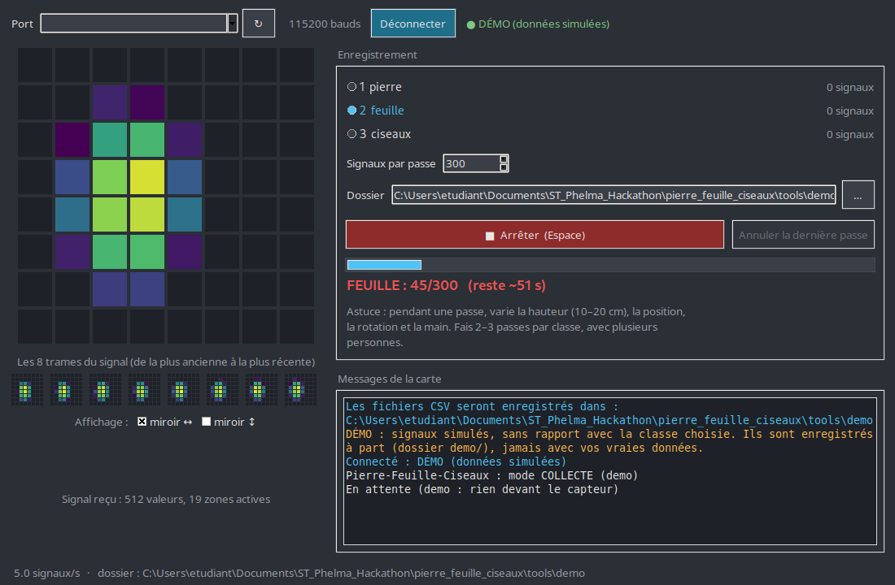

# Pierre – Feuille – Ciseaux contre le STM32

NUCLEO-L476RG + X-NUCLEO-53L5A1 (VL53L5CX, ToF 8×8) + **NanoEdge AI** (classification N-classes).

> 🚀 **Première fois ?** Suivre [`DEMARRAGE.md`](DEMARRAGE.md) : toutes les opérations dans l'ordre, de
> l'installation des logiciels à la première partie.

Tu montres ta main au capteur, le STM32 reconnaît **pierre / feuille / ciseaux** et joue contre toi.
Pour l'originalité, il propose aussi :

- **Un adversaire adaptatif** : un modèle de Markov apprend tes habitudes (« après pierre, il rejoue souvent
  pierre… ») et joue ce qui les bat. Il annonce ensuite ce qu'il avait prédit.
- **Une preuve qu'il ne triche pas** : avant le compte à rebours, le STM32 publie l'empreinte (FNV-1a) de son
  coup et d'un secret, puis révèle le secret après la manche. Comme il ne peut pas changer de coup après avoir
  vu le tien, l'empreinte permet de le vérifier.
- **Un vrai hasard** : pour ses coups au hasard et pour le secret de l'empreinte, le STM32 se sert des
  petites variations des distances mesurées par le capteur, qui changent à chaque mesure. Sans cela, ses
  tirages seraient les mêmes à chaque démarrage.

```
pierre_feuille_ciseaux/
├── NUCLEO_L476RG_TOF_PFC/     projet STM32CubeIDE = copie du projet ST NUCLEO_L476RG_TOF_VL53L5A1
│   ├── Inc/, Src/             + app, tof_sensor, tof_preproc, rps_game, rps_ai, uart_io
│   └── X-CUBE-TOF1/App/app_x-cube-tof1.c   modifié : appelle app_init() / app_loop() ; garde les
│                                           réglages du capteur de l'exemple ST (et leurs commentaires)
├── DEMARRAGE.md               les opérations dans l'ordre, pour une première fois
├── DIFFERENCES_ST.md          liste détaillée des différences avec le projet ST
├── tools/rps_logger_gui.py    collecte en interface graphique (tkinter), mode d'emploi en section 3
├── tools/rps_logger.py        la même chose en ligne de commande
├── tools/profil_collecte.json profil de ce projet pour l'outil commun outils/collecte_nanoedge.py
├── img/collecte_gui.png       capture de l'interface de collecte
├── pierre_feuille_ciseaux.pptx  présentation du projet (diapositives tirées de ce README)
└── tests/                     tests PC (make test) + CSV synthétiques (make synth)
```

---

## 1. Montage

- ⚠️ **Sortir les cartes de leur blister avec précaution** : les broches des connecteurs, sous les cartes,
  sont pointues et peuvent piquer les doigts. Tenir les cartes par les bords.
- Enficher la X-NUCLEO-53L5A1 sur la NUCLEO-L476RG (connecteurs Arduino).
- Poser la carte **à plat, capteur vers le plafond**. On joue la main 10–20 cm au-dessus, **paume vers le
  capteur**, doigts bien écartés pour « feuille » et en V bien ouvert pour « ciseaux ».
- La main doit être **entre 4 et 20 cm** au-dessus du capteur ; tout ce qui est au-delà de 20 cm est ignoré
  (réglage `PRE_FAR_MM`, voir [REGLAGE_DISTANCE.md](REGLAGE_DISTANCE.md)).

## 2. Projet STM32CubeIDE

Le dossier `NUCLEO_L476RG_TOF_PFC/` est le projet ST `NUCLEO_L476RG_TOF_VL53L5A1`, auquel l'application
a été ajoutée (voir `DIFFERENCES_ST.md`). Le brochage, l'I2C, le BSP X-CUBE-TOF1 et la librairie NanoEdge
viennent donc du projet ST : il n'y a rien à configurer.

1. *File > Import > Existing Projects into Workspace* → sélectionner `NUCLEO_L476RG_TOF_PFC/`.
2. Choisir le mode avec le symbole `APP_MODE` : `0` = collecte (valeur par défaut), `1` = jeu, dans
   `Inc/app_config.h`.
3. Compiler (Debug ou Release), puis flasher via le ST-LINK.

⚠️ Ne pas régénérer le code depuis le `.ioc` sans précaution (voir `DIFFERENCES_ST.md`, section 5).

## 3. Collecte des données (APP_MODE = 0)

1. Compiler avec `APP_MODE=0` (valeur par défaut) et flasher la carte.
2. Sur le PC : `pip install pyserial`, puis :
   ```bash
   python tools/rps_logger_gui.py                    # interface graphique (recommandé)
   python tools/rps_logger_gui.py --demo             # pour la découvrir sans carte (données simulées, dans tools/demo/)
   python tools/rps_logger.py --port COM5 --view     # ou en ligne de commande
   python tools/rps_logger.py --port COM5            # collecte guidée : pierre, feuille, ciseaux
   ```
   Ces deux scripts lancent l'**outil de collecte commun au dépôt** (`outils/collecte_nanoedge.py`) avec
   le profil de ce projet, `tools/profil_collecte.json` : classes, 512 valeurs par signal, affichage en
   grille 8×8. Voir [outils/README.md](../outils/README.md), et [tools/README.md](tools/README.md) pour
   la façon dont ce profil se déduit du firmware, et pour `tools/augmente_pfc.py`, qui fabrique des
   variantes plausibles des signaux réels (rotation, autre main, vitesse…) et met une partie des vrais
   signaux de côté pour vérifier dans le Studio que cela aide.
   Le mode d'emploi de l'interface graphique est juste après, dans « Utiliser l'interface de collecte ».
   La liaison série est **USART2 à 115200 bauds uniquement**, telle que le projet ST l'initialise : le
   firmware ne la reconfigure pas. À ce débit, la carte envoie un signal toutes les 3 trames
   (`PRE_DATALOG_EVERY`, 5 signaux/s) : une ligne de 512 valeurs prend jusqu'à 180 ms, et ce rythme
   garantit qu'aucune trame du capteur n'est manquée pendant l'envoi. Chaque passe ajoute 300 signaux par classe dans `pierre.csv`, `feuille.csv` et `ciseaux.csv`,
   **dans le dossier `tools/`, à côté des scripts**, quel que soit le dossier d'où on les lance. `--out` ou
   le champ « Dossier » de l'interface permettent d'en choisir un autre.
   **Faire 2–3 passes** en variant la hauteur, la position, la rotation, la main (gauche/droite), les
   personnes et l'éclairage. À 5 signaux par seconde, 300 signaux s'enregistrent en ~60 s.
3. Le firmware n'envoie rien quand aucune main n'est détectée. Il n'y a donc pas de classe « rien » : la
   présence de la main est détectée sans IA (`PRE_MIN_HAND_ZONES`).

**Format d'un signal** : 8 trames × 64 zones = 512 entiers, la même taille que la librairie modèle du projet
ST. Chaque zone vaut 0 (fond) ou 20…100 (main,
100 = point le plus proche). C'est donc un relief **indépendant de la hauteur de la main**, et la main est
**recentrée** dans la grille avant envoi.

### Utiliser l'interface de collecte (`rps_logger_gui.py`)



*Capture en mode `--demo`, pendant une passe « feuille » : 45 signaux sur 300, environ 51 s restantes.*

L'interface utilise tkinter, fourni avec Python sous Windows ; seul `pyserial` est à installer.

**Les zones de la fenêtre**

| Zone | Contenu |
|---|---|
| **Barre du haut** | *Port* : le port série de la carte (sous Windows, « STMicroelectronics STLink Virtual COM Port (COMx) ») ; ↻ relit la liste. Le débit (115200 bauds) vient du profil. *Connecter* / *Déconnecter*, puis l'état de la liaison (● vert = connecté). |
| **Grille 8×8** (à gauche) | La dernière trame reçue, vue du dessus. Case sombre = fond (pas de main) ; couleur = main, du violet (le plus loin) au jaune (le plus proche). Le firmware **recentre** la main dans la grille avant l'envoi : la tache reste donc vers le centre même si la main est décalée. |
| **Les 8 trames du signal** | Les 8 trames d'un signal, de la plus ancienne à la plus récente : c'est exactement ce qu'enregistre une ligne du CSV. |
| **Affichage : miroir ↔ / ↕** | Retournent **seulement l'affichage**, pas les fichiers. À régler pour que la grille bouge dans le même sens que la main (voir l'étape 3 ci-dessous). |
| **Ligne sous la grille** | « Signal reçu : 512 valeurs, N zones actives », ou « Aucun signal (rien devant le capteur ?) ». |
| **Enregistrement** (à droite) | Une ligne par classe, avec sa touche (`1` pierre, `2` feuille, `3` ciseaux) et le **nombre de signaux déjà dans son fichier**. *Signaux par passe* (300). *Dossier* : où sont écrits les CSV (`tools/` par défaut, *…* pour en choisir un autre). |
| **Enregistrer / Arrêter (Espace)** | Lance une passe pour la classe cochée, après un compte à rebours de 3 s affiché sur la grille, ou l'arrête avant la fin. |
| **Suppr. dernier (⌫)** | Retire le **dernier signal** enregistré (touche Retour arrière), pendant la passe (elle continue) ou juste après ; plusieurs appuis retirent les précédents, sans remonter avant le début de la passe. |
| **Annuler la dernière passe** | Retire du fichier les signaux de la **dernière** passe, après confirmation. Une seule passe peut être annulée. |
| **Barre de progression** | Classe en cours, signaux enregistrés sur la cible, durée restante ; un bip à la fin. En dessous, l'astuce du profil. |
| **Messages de la carte** | Les lignes `#` envoyées par la carte (« mode COLLECTE », « En attente d'une main… », qui se remplace au lieu de s'empiler), et celles de l'outil : connexion, fichiers, erreurs en orange ou rouge. |
| **Barre du bas** | Signaux reçus par seconde (**~5** avec une main au-dessus du capteur) et dossier des CSV. |

**Déroulement d'une collecte**

1. Flasher la carte en `APP_MODE 0`, **fermer Tera Term** (ou tout terminal série), puis lancer
   `python tools/rps_logger_gui.py`.
2. Choisir le port, puis *Connecter*. Les messages affichent « Pierre-Feuille-Ciseaux : mode COLLECTE »,
   puis « En attente d'une main… » tant qu'aucune main n'est au-dessus du capteur.
3. Placer la main **10 à 18 cm environ** au-dessus du capteur (au-delà de 20 cm, `PRE_FAR_MM`, elle est
   prise pour le fond) : la grille s'allume et le compteur du bas monte vers
   5 signaux/s. **Vérifier le sens** : déplacer la main vers la droite, puis vers soi. Si la tache part dans
   l'autre sens sur l'écran, cocher ou décocher *miroir ↔* ou *miroir ↕* (sans effet sur les fichiers).
4. Choisir la classe avec `1`, `2` ou `3`, puis **Espace**. Prendre la pose pendant le compte à rebours ;
   l'enregistrement dure ~60 s pour 300 signaux. **Pendant la passe, faire varier** la hauteur, la position,
   la rotation et l'inclinaison de la main, sans jamais changer de geste. Si la main sort du champ, la carte
   n'envoie plus rien et la passe se met en pause.
5. Passe ratée (mauvais geste, main sortie trop souvent) : **Annuler la dernière passe**.
6. Recommencer pour les trois classes, **2 ou 3 passes chacune**, si possible avec d'autres personnes et une
   autre main. Viser des nombres de signaux proches pour les trois classes.

Les fichiers `pierre.csv`, `feuille.csv` et `ciseaux.csv` sont alors prêts pour NanoEdge AI Studio
(section 4). Pour découvrir l'interface sans carte : `python tools/rps_logger_gui.py --demo`. Les signaux
simulés ne ressemblent pas à une main et vont dans `tools/demo/`, jamais avec les vraies données.

**Problèmes fréquents**

| Symptôme | Cause et solution |
|---|---|
| « Ouverture de COMx impossible … Le port est déjà utilisé » | Tera Term, une autre fenêtre de collecte ou la console série de CubeIDE garde le port : la fermer, puis *Connecter* |
| Liste des ports vide | Câble USB débranché, ou câble de charge seule : rebrancher, puis ↻ |
| « Ligne ignorée : … (profil ou mode de la carte ?) » | La carte n'est pas en mode collecte (`APP_MODE 1`) ou un autre projet est flashé |
| « Aucun signal » alors que la main est là | Main hors de la plage 40–200 mm, ou vue sur moins de `PRE_MIN_HAND_ZONES` (5) zones : la rapprocher. Pour changer la plage, voir [REGLAGE_DISTANCE.md](REGLAGE_DISTANCE.md) |
| `1`, `2`, `3` ou Espace sans effet | Le curseur est dans un champ (*Dossier*, *Signaux par passe*) : cliquer sur la grille, puis réessayer |

## 4. Générer la librairie NanoEdge AI

La librairie se génère dans **NanoEdge AI Studio**, le logiciel gratuit de ST (Windows ou Linux,
téléchargeable sur st.com). Tu y importes les fichiers CSV, il compare des centaines d'algorithmes, puis il
produit la librairie à copier dans le projet CubeIDE. Les noms d'écrans peuvent varier un peu selon la
version du Studio.

### Avant de commencer

- **Données** : au moins 200 à 300 signaux par classe, venant de 2 ou 3 passes variées. Varie les personnes, l'éclairage et la position de la main.
- **Données de test** : garde une passe à part (`--out test`, ou le dossier `tools/test/` dans
  l'interface). Elle ne doit pas servir à l'entraînement, seulement à la validation.
- **Format** : les fichiers sont déjà au bon format, une ligne par signal avec 512 entiers séparés par des
  virgules, sans en-tête.

### Étapes dans le Studio

1. **Créer le projet** : nouveau projet de type **N-Class classification**.
2. **Paramètres du projet** :
   - Cible : **STM32L476RG** (ou la carte NUCLEO-L476RG).
   - RAM et flash maximales : garder les valeurs proposées. La carte a 128 Ko de RAM et 1 Mo de flash,
     l'application n'en utilise qu'une petite partie.
   - Capteur : **Generic** avec **1 axe**. C'est la configuration de la librairie modèle du projet ST : la
     ligne de 512 valeurs est vue comme un seul signal.
   - Facultatif, si le temps le permet : refaire un projet avec **64 axes**, où chaque zone est suivie sur
     8 trames, et garder le meilleur des deux benchmarks. Le firmware accepte les deux, car il vérifie
     seulement que la librairie attend 512 valeurs.
3. **Signaux** : importer un fichier par classe (*Import from file*, séparateur virgule) : `pierre.csv`,
   `feuille.csv`, `ciseaux.csv`.
   - **Garder ces noms de classe.** Le firmware associe chaque classe à un coup par son nom
     (`pierre`/`rock`, `feuille`/`paper`, `ciseaux`/`scissors`), l'ordre d'import n'a donc pas d'importance.
   - Le Studio vérifie les fichiers : 512 valeurs par ligne, aucune valeur manquante.
4. **Benchmark** : le lancer. Il prend de quelques minutes à quelques dizaines de minutes. Viser une
   **précision équilibrée** (*balanced accuracy*) d'au moins 90 %. La matrice de confusion montre les
   classes confondues : si « ciseaux » est souvent pris pour « feuille », compléter les données de ces deux
   classes et relancer.
5. **Validation** : dans l'émulateur, importer les fichiers de **test**. Le taux de bonne reconnaissance
   doit rester proche de celui du benchmark. Utiliser des fichiers plutôt que la lecture série directe, car
   les lignes `#` du firmware peuvent la perturber.
6. **Compilation** : options à choisir pour correspondre au projet CubeIDE (vérifiées dans le `.cproject`) :
   - **Float ABI : hard**
   - **FPU : fpv4-sp-d16**

   Lancer la compilation : le Studio produit un `.zip`.

### Intégration dans le projet

1. Depuis le `.zip`, remplacer dans `NUCLEO_L476RG_TOF_PFC/` :
   - `Inc/NanoEdgeAI.h` ;
   - `Src/libneai.a` ;
   - avec une ancienne version du Studio, ajouter aussi `knowledge.h` dans `Inc/`. `rps_ai.c` gère les deux
     générations d'API.
2. Mettre `APP_MODE` à `1` dans `Inc/app_config.h`.
3. Recompiler, flasher, puis jouer (section 5).

### Messages d'erreur possibles

| Message | Cause et solution |
|---|---|
| `#error La librairie NanoEdge n'attend pas SIGNAL_LEN valeurs` | La taille du signal déclarée dans le Studio n'est pas 512. Refaire le projet Studio avec 1 axe (ou 64 axes) |
| Au démarrage : `# ERREUR : init NanoEdge (classes pierre/feuille/ciseaux introuvables ?)` | Les classes ne s'appellent pas pierre, feuille et ciseaux, ou c'est encore la librairie modèle de ST (2 classes) |
| Erreur d'édition de liens « uses VFP register arguments » / float-abi | Recompiler la librairie dans le Studio avec Float ABI **hard** et FPU **fpv4-sp-d16** |
| Reconnaissance bonne dans le Studio mais mauvaise sur la carte | Conditions différentes de la collecte (hauteur, éclairage, autre personne) : refaire une passe dans ces conditions et régénérer |

💡 **Sans matériel**, `cd tests && make synth` génère des CSV **synthétiques** dans `tests/data_synth/`. Ils
permettent de vérifier le format, le benchmark, la compilation et l'intégration, mais pas d'obtenir un vrai
modèle.

## 5. Jouer (APP_MODE = 1)

Compiler avec le symbole `APP_MODE=1` et la librairie NanoEdge générée (avec la librairie modèle de ST, le
démarrage s'arrête sur « init NanoEdge »), flasher, puis ouvrir un terminal série (PuTTY, Tera Term,
`screen`, `minicom`…) à **115200 bauds**.

| Touche | Action |
|---|---|
| **B1** (bouton bleu), `espace` ou `Entrée` | Jouer une manche |
| `m` | Stratégie adaptative ↔ aléatoire |
| `r` | Remise à zéro du score |
| `d` | Affichage en direct de la reconnaissance (coup, probabilité de chaque classe, nb de zones, distance) : voir ci-dessous |
| `h` | Menu |

**Affichage en direct (`d`).** Hors manche, quand une main est devant le capteur, la carte classe le
signal toutes les 300 ms environ et affiche une ligne :

```
  [direct] pierre 87%  (pierre 87% feuille 9% ciseaux 4%)  (14 zones, 152 mm)
           ^^^^^^^^^^   ^^^^^^^^^^^^^^^^^^^^^^^^^^^^^^^^^   ^^^^^^^^^^^^^^^^^
           coup retenu  probabilité de chaque classe        zones de main, distance mini
```

- **Coup retenu** : la classe la plus probable et sa probabilité. En manche, un vote ne compte que si
  cette probabilité atteint `GAME_MIN_CONFIDENCE` (60 %).
- **Probabilités** : celles que renvoie `neai_classification()`, une par classe, de somme ≈ 100 %. Elles
  sont dans l'**ordre des classes de la librairie NanoEdge** (l'ordre d'import des CSV dans le Studio),
  pas forcément pierre, feuille, ciseaux, et portent le nom de la classe. Elles montrent si le modèle
  hésite : `pierre 52% ciseaux 45%` signale deux classes mal séparées. C'est le moment de collecter
  plus de signaux ou de varier la hauteur et la position de la main.
- **Dans le code** : le tableau `probs` de `Src/rps_ai.c` est rempli par chaque classification ;
  `rps_ai_class_count()`, `rps_ai_class_name(k)` et `rps_ai_class_prob(k)` (déclarées dans
  `Inc/rps_ai.h`) le lisent depuis le reste du programme ; l'affichage est fait dans `Src/app.c`
  (état `ST_IDLE`). Au débogueur : point d'arrêt après `neai_classification()` dans `rps_ai.c`, et
  `probs` dans la vue *Expressions*.

Déroulement : *« Pierre… Feuille… Ciseaux… CHIFOUMI ! »* (la LED clignote), puis tu montres ton coup. Le
STM32 cumule 5 classifications concordantes (confiance ≥ 60 %) et affiche le duel, le gagnant, sa
prédiction, la vérification de l'empreinte et le score. La LED reste allumée si le STM32 a gagné.

```
     TOI            STM32
     _____       vs     ____
    |     |      vs    (____)
    |     |      vs    (____)
    |_____|      vs    (____)
   FEUILLE          PIERRE

  >>> TU GAGNES ! FEUILLE bat PIERRE
  (je pensais que tu jouerais CISEAUX ... rate.)
  Verification : coup=PIERRE secret=8f3a1c2e -> empreinte 5b0e93d1
  Score >> Toi 3 - 2 STM32   (egalites : 1)
```

## 6. Réglages pour améliorer la réponse (`NUCLEO_L476RG_TOF_PFC/Inc/app_config.h`)

Les leviers se rangent en trois familles, selon ce qu'il faut refaire après un changement.

### Réglages de décision : sans recollecter

Ils agissent **après** NanoEdge, sur la façon dont le jeu utilise ses réponses. Recompiler suffit : la
librairie reste la même. Ce sont les premiers à essayer.

| Paramètre | Défaut | Rôle | Si… |
|---|---|---|---|
| `GAME_MIN_CONFIDENCE` | 0.60 | Probabilité mini pour qu'une classification compte comme vote | « Je n'ai pas bien vu ta main » fréquent → 0.5 ; mauvais coups reconnus → 0.7 |
| `GAME_VOTES_NEEDED` | 5 | Classifications concordantes avant de décider | Réponse lente → 3 ; décision instable → 7 |
| `GAME_CAPTURE_MS` | 2500 | Fenêtre pour montrer son geste après « CHIFOUMI » | Joueurs trop lents (manche annulée) → 3500 |
| `GAME_EXPLORATION_PCT` | 20 | % de coups aléatoires de l'adversaire adaptatif | Trop prévisible → augmenter |

### Réglages du signal : recollecter et régénérer la librairie

Ils changent les données envoyées à NanoEdge : une librairie entraînée sur l'ancien signal ne marche plus,
ou mal. Après un changement : recollecter les trois classes, refaire le benchmark, remplacer la librairie.

| Paramètre | Défaut | Rôle | Si… |
|---|---|---|---|
| `PRE_NEAR_MM` / `PRE_FAR_MM` | 40 / 200 mm | Plage où la main est vue ; au-delà de `PRE_FAR_MM`, c'est le fond (voir [REGLAGE_DISTANCE.md](REGLAGE_DISTANCE.md)) | Fond détecté comme une main → diminuer `PRE_FAR_MM` |
| `PRE_DEPTH_WINDOW_MM` | 120 mm | Profondeur gardée derrière le point le plus proche | Avant-bras gênant → diminuer |
| `PRE_MIN_HAND_ZONES` | 5 | Zones mini pour dire qu'une main est là | Fausses détections → augmenter |
| `PRE_RECENTER` / `PRE_MAX_SHIFT` | 1 / 2 | Recentrage de la main dans la grille (robustesse à la position) | Positions très variées → `PRE_MAX_SHIFT` 3 |
| `PRE_FRAMES_PER_SIGNAL` | 8 | Trames par signal (512 valeurs) | Réponse plus vive → 4 (256 valeurs : aussi `longueur` dans `tools/profil_collecte.json` et dans le Studio) |
| `TOF_TARGET_CLOSEST` | 1 | Cible la plus proche par zone (la main) | Main mal vue au-dessus d'un objet brillant → essayer 0 |

⚠️ `PRE_FRAMES_PER_SIGNAL`, `PRE_NEAR_MM` / `PRE_FAR_MM` et `TOF_FREQ_HZ` existent aussi dans
`X-CUBE-TOF1/App/app_x-cube-tof1.c` (`SUCCESSIVE_MATRIX`, `MIN_THRESHOLD` / `MAX_THRESHOLD`,
`Profile.Frequency`) : les modifier **des deux côtés**, sinon un `#error` dit laquelle.

### Les données et le Studio : souvent le levier le plus efficace

- **Plus de passes, plus variées** : autres personnes, autre main, hauteurs, rotations, éclairages.
- **Classes équilibrées** : des nombres de signaux proches pour pierre, feuille et ciseaux.
- **Données de test à part** (`--out test`) pour vérifier dans l'émulateur que le modèle généralise.
- **Matrice de confusion** du benchmark : elle montre quelles classes sont confondues, donc lesquelles
  compléter (souvent ciseaux / feuille, voir plus bas).
- **1 axe ou 64 axes** dans le Studio : essayer les deux et garder le meilleur benchmark.
- **Augmentation** : `tools/augmente_pfc.py` fabrique des variantes plausibles des vrais signaux (rotation,
  autre main, vitesse) et met une partie des vrais signaux de côté pour vérifier que cela aide (voir
  [tools/README.md](tools/README.md)).
- **Diagnostic sur la carte** : la touche `d` affiche en direct la probabilité de chaque classe
  (section 5) ; deux classes proches l'une de l'autre signalent des données à compléter.

### À ne pas changer

| Paramètre | Défaut | Pourquoi |
|---|---|---|
| `APP_UART_BAUD` | 115200 | Débit de l'USART2 tel que `main.c` (projet ST) l'initialise (`#error` sinon) |
| `PRE_DATALOG_EVERY` | 3 | Collecte : un signal toutes les 3 trames, pour ne perdre aucune trame à 115200 bauds. Messages coupés → 4 |

**Réglages du capteur** : ils restent ceux de l'exemple ST, avec ses commentaires, dans
`X-CUBE-TOF1/App/app_x-cube-tof1.c` (`SUCCESSIVE_MATRIX`, `MATRIX_RESOLUTION`, `MIN_THRESHOLD` /
`MAX_THRESHOLD`, `NEAI_MODE`, `Profile.*`, `ITConfig.*`). Seules différences : interruption à chaque trame
(`RS_IT_DEFAULT`) et seuils 40 / 200 mm. Les valeurs partagées avec `app_config.h` (`PRE_FRAMES_PER_SIGNAL`,
`TOF_ZONES`, `PRE_NEAR_MM` / `PRE_FAR_MM`, `TOF_FREQ_HZ`) doivent être modifiées **des deux côtés** : sinon
la compilation s'arrête sur un `#error` qui dit laquelle.

**Ciseaux confondus avec feuille ?** C'est la paire la plus difficile en 8×8. Écarter franchement les deux
doigts en V, replier les autres, et collecter davantage de données « ciseaux » sous différents angles.

## 7. Tests sur PC

```bash
cd tests
make test     # prétraitement (seuils, statuts, recentrage, fenêtre glissante) + logique de jeu
make synth    # CSV synthétiques pour essayer NanoEdge AI Studio
```
