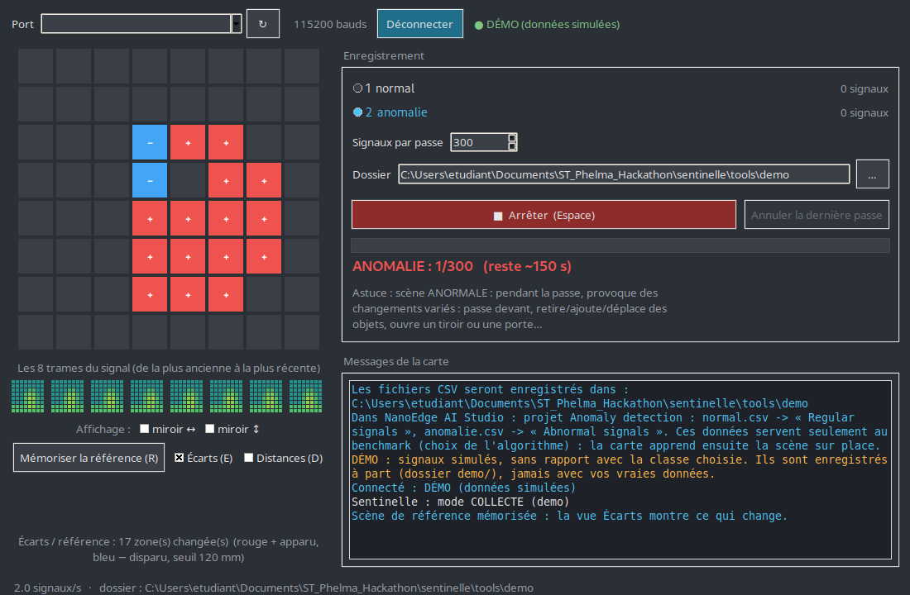

# Sentinelle : une carte qui apprend sa scène sur place

NUCLEO-L476RG + X-NUCLEO-53L5A1 (VL53L5CX, ToF 8×8) + **NanoEdge AI Anomaly detection, apprentissage
embarqué**.

Tu poses la carte face à un bureau, une étagère ou une porte, puis tu la mets sous tension. En ~25 s, elle
apprend **seule, sans PC**, à quoi ressemble la scène normale. Elle surveille ensuite et signale tout
changement :

```
[3:42] !!! ALARME #2 : la scene a change (similarite 41%)
    Carte des changements (+ apparu/rapproche, - disparu/eloigne) : 3 zone(s)
      . . . . . . . .
      . . . . . . . .
      . . . . . . . .
      . . . . . . . .
      . . . . . . . .
      . . . . . . - -
      . . . . . . - .
      . . . . . . . .
    [B1 court] si c'est normal desormais.
[3:51] Retour a la normale apres 9 s (similarite mini 38%)
```

> 🚀 **Première fois ?** Suivre [`DEMARRAGE.md`](DEMARRAGE.md) : toutes les opérations dans l'ordre, de
> l'installation des logiciels à la surveillance.

Ce qui la rend originale :

- **Apprentissage embarqué** (ce que NanoEdge a d'unique) : le modèle n'est pas entraîné sur PC. La carte
  apprend son environnement là où elle est installée, et on peut la déplacer et lui faire réapprendre en
  appuyant sur un bouton.
- **Apprentissage incrémental** : *« oui, ce changement est normal maintenant »*. Un appui court sur B1
  ajoute la nouvelle situation à la connaissance existante, sans tout effacer.
- **Alarme expliquée** : NanoEdge donne un score de similarité (0–100 %). En parallèle, la carte apprend la
  moyenne et l'écart-type de chaque zone, ce qui permet d'afficher **où** la scène a changé et **dans quel
  sens** (`+` objet apparu / quelqu'un devant, `-` objet disparu).
- **Alarme avec hystérésis** : il faut 3 signaux anormaux d'affilée pour lever l'alarme, et 3 normaux pour la
  retirer. Il n'y a donc pas de fausse alerte sur une mesure bruitée.

```
sentinelle/
├── NUCLEO_L476RG_TOF_SENTINELLE/   projet STM32CubeIDE = copie du projet ST NUCLEO_L476RG_TOF_VL53L5A1
│   ├── Inc/, Src/                  + app, tof_sensor, scene_preproc, sentinel_ai, uart_io
│   └── X-CUBE-TOF1/App/app_x-cube-tof1.c   modifié : appelle app_init() / app_loop() ; garde les
│                                           réglages du capteur de l'exemple ST (et leurs commentaires)
├── DEMARRAGE.md                    les opérations dans l'ordre, pour une première fois
├── DIFFERENCES_ST.md               liste détaillée des différences avec le projet ST
├── tools/sentinel_logger_gui.py    collecte en interface graphique (outil commun outils/, tkinter)
├── tools/sentinel_logger.py        la même chose en ligne de commande
├── tools/profil_collecte.json      profil de collecte : classes, format du signal, affichage
├── img/collecte_gui.png            capture de l'interface de collecte
├── sentinelle.pptx                 présentation du projet (diapositives tirées de ce README)
└── tests/                          tests PC (make test) + CSV synthétiques (make synth)
```

---

## 1. Montage et installation

- ⚠️ **Sortir les cartes de leur blister avec précaution** : les broches des connecteurs, sous les cartes,
  sont pointues et peuvent piquer les doigts. Tenir les cartes par les bords.
- Enficher la X-NUCLEO-53L5A1 sur la NUCLEO-L476RG (connecteurs Arduino), puis brancher le câble USB
  (ST-LINK). Il alimente la carte ; le terminal série reste facultatif en surveillance.
- **Poser la carte face à la scène** à surveiller (bureau, étagère, porte), capteur tourné vers elle, à
  **0,5–3 m**. Au-delà de 3 m (`SENT_MAX_MM`), tout est compté comme « loin ».
- **Fixer la carte** (adhésif, support, pile de livres) : le moindre déplacement du capteur change toute la
  scène et déclenche une alarme, ou fausse une collecte.
- Éviter le **soleil direct** sur la scène ou sur le capteur : il dégrade les mesures.

## 2. Projet STM32CubeIDE

Le dossier `NUCLEO_L476RG_TOF_SENTINELLE/` est le projet ST `NUCLEO_L476RG_TOF_VL53L5A1`, auquel
l'application a été ajoutée (voir `DIFFERENCES_ST.md`). Le brochage, l'I2C, le BSP X-CUBE-TOF1 et l'UART à
115200 bauds viennent du projet ST : il n'y a rien à configurer.

1. *File > Import > Existing Projects into Workspace* → sélectionner `NUCLEO_L476RG_TOF_SENTINELLE/`. Il
   peut cohabiter avec `NUCLEO_L476RG_TOF_PFC` dans le même workspace.
2. Choisir le mode avec le symbole `APP_MODE` : `0` = collecte (valeur par défaut), `1` = sentinelle,
   dans `Inc/app_config.h`.
3. Compiler, puis flasher via le ST-LINK.

⚠️ Le mode `1` demande votre librairie NanoEdge (section 5) : la librairie modèle fournie par ST, de
classification sans classe `normal`, s'arrête sur « init NanoEdge ».
⚠️ Ne pas régénérer le code depuis le `.ioc` sans précaution (voir `DIFFERENCES_ST.md`, section 5).

> **Deux types de librairie NanoEdge sont acceptés** (détail à la fin de la section 5) :
> - **Anomaly detection** (le projet est conçu pour elle) : la carte **apprend sur place** sa scène normale ;
>   les CSV ne servent qu'à choisir l'algorithme.
> - **N-Class classification** avec les classes `normal` et `anomalie` : le modèle est **appris dans le
>   Studio** avec vos CSV et figé ; la carte surveille dès le démarrage, sans phase d'apprentissage.

## 3. Pourquoi collecter des données si l'apprentissage est embarqué ?

Le Studio a besoin d'exemples pour **choisir l'algorithme** (prétraitement et modèle) le mieux adapté à ce
type de signal. La librairie générée ne contient **aucune connaissance**, juste l'algorithme vierge. La
connaissance est apprise ensuite sur la carte, à son emplacement final.

Le benchmark peut donc se faire **sur une scène différente** de celle qui sera surveillée, tant qu'elle est
du même genre (bureau, pièce, porte…).

## 4. Collecte (APP_MODE = 0)

1. Compiler avec `APP_MODE=0` (valeur par défaut), flasher, puis installer la carte face à la scène
   (section 1).
2. Sur le PC : `pip install pyserial`, puis :
   ```bash
   python tools/sentinel_logger_gui.py                  # interface graphique (recommandé)
   python tools/sentinel_logger_gui.py --demo           # pour la découvrir sans carte (données simulées)
   python tools/sentinel_logger.py --port COM5 --view   # ou en ligne de commande
   python tools/sentinel_logger.py --port COM5          # normal.csv puis anomalie.csv
   ```
   Ces deux scripts lancent l'outil de collecte commun du dépôt ([outils/](../outils/README.md)) avec le
   profil `tools/profil_collecte.json`. Le mode d'emploi de l'interface est juste après, dans « Utiliser
   l'interface de collecte ».
3. La carte envoie un signal **en continu**, même quand rien ne bouge : **~2 signaux/s** (un toutes les
   8 trames), à 115200 bauds. Une passe de 300 signaux dure donc **~2 min 30**.
4. Les fichiers `normal.csv` et `anomalie.csv` sont enregistrés **dans le dossier `tools/`, à côté des
   scripts**. `--out` ou le champ « Dossier » de l'interface permettent d'en choisir un autre.
   - **normal** : scène immobile, **personne dans le champ** (lancer la passe, puis sortir du champ
     pendant le compte à rebours). Plusieurs passes : lumière allumée ou éteinte, heures différentes,
     petites variations acceptables (chaise un peu déplacée…).
   - **anomalie** : passer devant, retirer, ajouter ou déplacer des objets, ouvrir un tiroir… le plus varié
     possible.

**Format d'un signal** : 8 trames × 64 zones = 512 entiers, la même taille que la librairie modèle du projet
ST. Chaque zone vaut `100 × distance / 3000 mm` (1 unité = 30 mm) ; **100** = 3 m ou plus, ou pas de cible.
Contrairement à Pierre-Feuille-Ciseaux, rien n'est recentré : on garde les **distances absolues de toute la
scène**, puisque c'est elle qu'on apprend.

### Utiliser l'interface de collecte (`sentinel_logger_gui.py`)



*Capture en mode `--demo` : la référence a été mémorisée (R), la vue Écarts montre l'objet simulé qui est
apparu (+ rouge) ou a quitté une zone (− bleu), pendant une passe « anomalie ».*

L'interface est la même que pour Pierre-Feuille-Ciseaux (voir son
[README](../pierre_feuille_ciseaux/README.md#utiliser-linterface-de-collecte-rps_logger_guipy)), avec des
outils en plus pour une scène :

| Zone | Contenu |
|---|---|
| **Grille 8×8** | La dernière trame : **proche = clair, loin = sombre**, case vide = pas de cible. Toute la scène est visible, pas seulement un objet |
| **Distances (D)** | Écrit dans chaque case la distance en cm ; sous la grille, la distance de l'objet le plus proche |
| **Mémoriser la référence (R)** | Enregistre la scène actuelle (trame moyenne du dernier signal) comme référence et active la vue Écarts |
| **Écarts (E)** | Zones qui ont changé de plus de 120 mm par rapport à la référence : `+` rouge = apparu ou rapproché, `−` bleu = disparu ou éloigné, comme la carte des changements du firmware |
| **Enregistrement** | Touche `1` normal, `2` anomalie ; l'astuce sous la barre change avec la classe |
| **Messages de la carte** | « Sentinelle : mode COLLECTE », puis rien d'autre : la carte n'envoie que des signaux |

**Déroulement d'une collecte**

1. Flasher en `APP_MODE 0`, **fermer Tera Term**, lancer `python tools/sentinel_logger_gui.py`, choisir le
   port, puis *Connecter* : la grille s'anime aussitôt (~2 signaux/s).
2. Scène normale, personne devant : appuyer sur **R** pour mémoriser la référence. La vue Écarts doit
   montrer très peu de zones changées.
3. **Vérifier que les anomalies sont vues** : passer devant, déplacer un objet. Les `+` / `−` doivent
   apparaître au bon endroit ; un objet trop petit ou trop loin ne sera pas vu non plus par la carte.
4. Choisir `1` (normal), appuyer sur **Espace** et **sortir du champ** pendant le compte à rebours. Ne
   rien toucher pendant ~2 min 30.
5. Choisir `2` (anomalie), **Espace**, puis provoquer des changements variés pendant toute la passe.
6. Recommencer : **2 ou 3 passes par classe**, dans des conditions différentes. Une passe ratée (quelqu'un
   est passé pendant « normal ») se retire avec **Annuler la dernière passe**.

**Problèmes fréquents** : ceux de Pierre-Feuille-Ciseaux (port occupé, liste des ports vide, touches sans
effet quand le curseur est dans un champ), plus :

| Symptôme | Cause et solution |
|---|---|
| Beaucoup de zones changées sans que rien ne bouge | Référence mémorisée alors que quelqu'un était dans le champ, ou carte qui a bougé : la refixer, puis **R** |
| Grille presque vide (peu de cases colorées) | Rien à moins de 3 m : la scène est trop loin (ou le capteur mal orienté) : rapprocher la carte |
| « Ligne ignorée : … (profil ou mode de la carte ?) » | La carte n'est pas en mode collecte (`APP_MODE 1`) ou un autre projet est flashé |

## 5. Générer la librairie NanoEdge AI

La librairie se génère dans **NanoEdge AI Studio**, le logiciel gratuit de ST (Windows ou Linux,
téléchargeable sur st.com). Tu y importes les fichiers CSV, il compare des centaines d'algorithmes, puis il
produit la librairie à copier dans le projet CubeIDE. Les noms d'écrans peuvent varier un peu selon la
version du Studio.

### Avant de commencer

- **Données** : au moins 200 à 300 signaux par classe, venant de 2 ou 3 passes variées. Pour « normal » : lumière allumée/éteinte, heures différentes.
  Pour « anomalie » : passages, objets ajoutés, retirés ou déplacés, tiroirs, portes.
- **Données de test** : garde une passe de chaque classe à part, pour la validation : relancer l'outil avec
  `--out test` (les fichiers vont dans `tools/test/`).
- **Format** : les fichiers sont déjà au bon format, une ligne par signal avec 512 entiers séparés par des
  virgules, sans en-tête.
- **Rappel** : ces données servent seulement à **choisir l'algorithme**. La librairie générée ne contient
  aucune connaissance, c'est la carte qui apprend sa scène sur place.

### Étapes dans le Studio

1. **Créer le projet** : nouveau projet de type **Anomaly detection**.
2. **Paramètres du projet** :
   - Cible : **STM32L476RG** (ou la carte NUCLEO-L476RG).
   - RAM et flash maximales : garder les valeurs proposées. L'apprentissage embarqué utilise de la RAM, mais
     la carte a 128 Ko.
   - Capteur : **Generic** avec **1 axe**, comme la librairie modèle du projet ST. Facultatif : essayer aussi
     **64 axes** et garder le meilleur benchmark. Le firmware accepte les deux, car il vérifie seulement
     qu'il y a 512 valeurs.
3. **Signaux** (*Import from file*, séparateur virgule) :
   - *Regular signals* ← `normal.csv`
   - *Abnormal signals* ← `anomalie.csv`
4. **Benchmark** : le lancer, puis viser une **précision équilibrée** (*balanced accuracy*) d'au moins
   90 %. En dessous, ajouter des passes plus variées (surtout « normal », pour éviter les fausses alarmes)
   et relancer.
5. **Validation** : dans l'émulateur, faire un apprentissage avec des signaux normaux, puis une détection
   sur les fichiers de **test**. Relever le **nombre minimal d'apprentissages conseillé** affiché par le
   Studio : s'il dépasse 40, le reporter dans `SENT_LEARN_SIGNALS` (`Inc/app_config.h`). Chaque signal
   dure environ 0,5 s.
6. **Compilation** : options à choisir pour correspondre au projet CubeIDE (vérifiées dans le `.cproject`) :
   - **Float ABI : hard**
   - **FPU : fpv4-sp-d16**

   Lancer la compilation : le Studio produit un `.zip`.

### Intégration dans le projet

1. Depuis le `.zip`, remplacer dans `NUCLEO_L476RG_TOF_SENTINELLE/` :
   - `Inc/NanoEdgeAI.h` ;
   - `Src/libneai.a`.

   Il n'y a jamais de `knowledge.h` pour une librairie de détection d'anomalie.
2. Mettre `APP_MODE` à `1` dans `Inc/app_config.h`.
3. Recompiler, flasher, installer la carte face à la scène, puis la mettre sous tension (section 6).

### Variante : librairie de classification

Une librairie **N-Class classification** générée avec les deux classes `normal` et `anomalie` (les mêmes
CSV) est aussi acceptée : le firmware reconnaît le type de librairie à la compilation.

| | Anomaly detection | N-Class classification |
|---|---|---|
| Ce que contient la librairie | L'algorithme seul, vierge | Le modèle appris sur vos CSV |
| Au démarrage | 5 s pour sortir du champ, puis ~21 s d'apprentissage | **Surveillance immédiate** |
| Valeur affichée | `similarite` à la normale apprise | `proba normal` : probabilité de la classe `normal` |
| B1, `l`, `a` | Apprendre ou réapprendre | Sans effet |
| Nouvelle scène ou carte déplacée | B1 long : la carte réapprend | Recollecter et régénérer la librairie |

Dans les deux cas, l'alarme se déclenche sous le seuil (90 %). L'IA dit **s'il y a** une anomalie ; la
carte des changements, affichée avec l'alarme, montre **où**. Cette carte n'utilise pas l'IA : elle compare
chaque zone à une moyenne de la scène, mémorisée pendant l'apprentissage (anomalie) ou, sans message,
pendant la première seconde (classification).

### Messages d'erreur possibles

| Message | Cause et solution |
|---|---|
| `#error La librairie NanoEdge n'attend pas SENT_SIGNAL_LEN valeurs` | La taille du signal déclarée dans le Studio n'est pas 512. Refaire le projet Studio avec 1 axe (ou 64 axes) |
| `ERREUR : init NanoEdge (pas de classe "normal" dans la librairie) (code -2)` | La librairie est une librairie de **classification** sans classe `normal` (par exemple la librairie modèle de ST). Refaire le projet Studio avec les fichiers `normal.csv` et `anomalie.csv` |
| Erreur d'édition de liens « uses VFP register arguments » / float-abi | Recompiler la librairie dans le Studio avec Float ABI **hard** et FPU **fpv4-sp-d16** |
| Fausses alarmes fréquentes sur la carte | Apprentissage trop court ou scène qui varie (lumière) : appui court sur B1 dans ces conditions, augmenter `SENT_LEARN_SIGNALS`, ou baisser le seuil avec `-` |

💡 **Sans matériel**, `cd tests && make synth` génère `normal.csv` et `anomalie.csv` **synthétiques** dans
`tests/data_synth/`. Ils permettent de vérifier le format, le benchmark, la compilation et l'intégration,
mais pas d'obtenir un vrai modèle.

## 6. Utilisation (APP_MODE = 1)

Compiler avec `APP_MODE=1`, flasher, installer la carte, puis la mettre sous tension. Le terminal série
(**115200 bauds**, comme dans le projet ST) est **facultatif** : la LED et le bouton suffisent.

| LED LD2 | État |
|---|---|
| Clignote lentement (1 Hz) | Sors du champ : l'apprentissage commence dans 5 s |
| Allumée fixe | Apprentissage en cours (~21 s), ne touche à rien |
| Éteinte | Surveillance |
| Clignote vite | **ALARME** |

| Commande | Action |
|---|---|
| **B1 appui long** (> 1,5 s) ou `l` | Tout réapprendre (la connaissance est effacée) |
| **B1 appui court** ou `a` | Ajouter la situation actuelle comme normale (incrémental) |
| `+` / `-` | Seuil d'alarme ± 5 % (90 % par défaut) |
| `v` | Similarité en continu : `similarite  97% [###################-]` |
| `c` | Afficher la carte des changements maintenant |
| `h` | Menu |

**Avec une librairie de classification**, la LED reste éteinte dès le démarrage (surveillance) et la ligne
`v` affiche `proba normal  97% [...]`. B1, `l` et `a` sont sans effet. Une alarme sur une situation
désormais normale ne se corrige pas sur la carte : il faut recollecter et régénérer la librairie.

**Idée de démo** : installer la sentinelle devant un stand avec 3 objets. Elle apprend la scène. On retire
un objet → alarme et `-` à sa place. On le remet → retour à la normale. On ajoute un objet puis on appuie sur
B1 (court) → il fait désormais partie de la normalité.

## 7. Réglages (`NUCLEO_L476RG_TOF_SENTINELLE/Inc/app_config.h`)

| Paramètre | Rôle | Si… |
|---|---|---|
| `SENT_THRESHOLD` (90) | Similarité en dessous de laquelle le signal est anormal | Fausses alarmes → diminuer (ou `-`) |
| `SENT_CONFIRM` (3) | Signaux consécutifs pour lever / retirer l'alarme | Alarme trop nerveuse → augmenter |
| `SENT_LEARN_SIGNALS` (40) | Signaux appris par session (8 trames chacun, ~21 s) | Valeur conseillée par le Studio |
| `SENT_LEARN_DELAY_MS` (5000) | Délai pour sortir du champ | — |
| `SENT_MAX_MM` (3000) | Distance d'écrêtage | Grande pièce → 4000 |
| `SENT_MAP_MIN_MM` / `SENT_MAP_SIGMAS` | Sensibilité de la carte des changements | Carte trop bavarde → augmenter |

## 8. Limites connues

- **La connaissance est perdue à chaque redémarrage** : la carte réapprend au démarrage, ce qui est voulu
  ici. La sauvegarder en flash dépend de la version de la librairie NanoEdge et n'est pas implémenté.
- **Orientation de la carte des changements** : selon le sens de montage, la grille peut apparaître en
  miroir par rapport à ce que tu vois. Repère-toi une fois en passant la main d'un côté.
- **Lumière** : un soleil direct très fort dégrade les mesures du VL53L5CX. Il faut alors apprendre dans les
  mêmes conditions, ou ajouter des passes « normal » sous différents éclairages.

## 9. Tests sur PC

```bash
cd tests
make test     # signal, carte des changements (objet retiré, personne), alarme avec hystérésis
make synth    # CSV synthétiques pour essayer NanoEdge AI Studio
```
